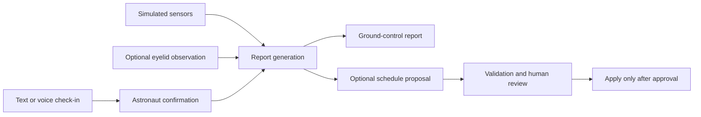

<div align="center">

# S.L.O.T.H.

### An AI companion for astronaut wellbeing

**Listen · Observe · Understand · Propose · Review**

Built by **3DC** for the **NASA Space Apps Challenge 2026**

[Presentation](https://drive.google.com/file/d/1JcPrC6I3E8_bsG6HXRX22iwkgv804zUT/view?usp=sharing) · [Demo video](docs/media/SLOTH_demo.mp4) · [Scientific foundation](S.L.O.T.H._Scientific_Foundation.pdf) · [Run locally](#run-locally) · [AI disclosure](docs/AI_USE.md)

</div>

---

SLOTH brings together an astronaut-facing AI companion and a ground-control dashboard. It combines conversational wellbeing check-ins, simulated sensor readings and optional webcam observations to give astronauts and mission operators more context than measurements alone.

**The assistant proposes. Ground control decides.** Schedule changes require explicit review and approval before they are applied.

## Explore the project

| Material | What you will find |
| --- | --- |
| [Submission presentation — 7 slides](https://drive.google.com/file/d/1JcPrC6I3E8_bsG6HXRX22iwkgv804zUT/view?usp=sharing) | The problem, solution, prototype and team. Public PDF. |
| [Watch or download the demo video](docs/media/SLOTH_demo.mp4) | A silent, 58-second walkthrough of the dashboard, 3D bodies, eyelid observation, chat, reports and schedule. Supplemental material. |
| [Scientific foundation](S.L.O.T.H._Scientific_Foundation.pdf) | Research-to-design traceability, references, limitations and evaluation hypotheses. |
| [AI / SI disclosure](docs/AI_USE.md) | How AI tools were used in development, visuals, synthetic data and speech. |
| [Challenge](https://www.spaceappschallenge.org/2026/challenges/health-monitoring-software/) | *Create Health Monitoring Software for Astronauts on Space Missions*. |

The repository provides a local prototype. The presentation and video can be viewed without running the application. GitHub may offer the video as a downloadable file; use **View raw** or **Download** if inline playback is unavailable.

## What SLOTH does

| Feature | Demonstrated behaviour |
| --- | --- |
| **Mission dashboard** | Fictional crew profiles, interactive 3D human models and synthetic health measurements. |
| **AI companion** | Text and voice interaction about sleep, fatigue, physical wellbeing and the astronaut's day. |
| **Eyelid observation** | Webcam tracking of eyelid closures within a defined observation interval, including quality and limitations. |
| **Confirmed check-in** | The astronaut reviews information and chooses observations to share before report generation. |
| **Ground-control report** | Self-reports, simulated measurements and optional webcam observations, with discrepancies and uncertainty kept explicit. |
| **Schedule proposals** | Validated proposals for human review, such as a short rest before a future flexible activity. |
| **Private diary** | A reflection artifact separate from the operational report. |

The reaction-time test is available as a **separate prototype** at `/reaction-demo`; it is not integrated into the main report workflow.

## From conversation to ground-control review



Our focus is **isolation and confinement** and **distance from Earth**. NASA's [5 Hazards of Human Spaceflight](https://www.nasa.gov/hrp/hazards/) provides background for this focus. The [scientific foundation](S.L.O.T.H._Scientific_Foundation.pdf) explains how research informed the design and where further evaluation is needed.

Crew profiles and sensor readings are **synthetic**, not real astronaut telemetry. Webcam observations describe eyelid closures only within the recorded interval; they do not measure sleep duration, diagnose fatigue or establish emotional state. SLOTH is an experimental support prototype, not a medical device or an operational NASA system.

## Technology

| Component | Technologies |
| --- | --- |
| Dashboard and agent APIs | TypeScript, React, Next.js |
| 3D visualisation | Three.js, React Three Fiber |
| Data backend | Python, FastAPI |
| Eyelid observation | MediaPipe, React, Vite |
| Local persistence | Prisma + SQLite for the agent; a separate SQLite archive for Python observations |
| AI conversation | Configurable providers, including NVIDIA Nemotron; a mock provider for setup without an API key |
| Voice | Browser speech recognition and synthesis; optional configured server speech providers |
| Presentation video | Remotion and FFmpeg |

## Run locally

### 1. Prerequisites

- **Node.js 24.15+ within the 24.x series**, **npm 11** — required by the vision prototype.
- **Python 3.12+**.
- A browser, webcam and microphone for the optional camera/voice features.
- A NVIDIA API key to run the real conversational model. The mock provider requires no key.

The following commands use **Windows PowerShell**, starting at the repository root. Use `npm.cmd` if PowerShell blocks `npm.ps1`.

### 2. Clone and install

```powershell
git clone https://github.com/fabriziodrr/nasa_space_app_challenge.git
cd nasa_space_app_challenge

npm.cmd ci
npm.cmd --prefix feature-visione-palpebrale/vision-prototype ci

cd server
py -3.12 -m venv .venv
.\.venv\Scripts\python.exe -m pip install -e ".[dev]"
cd ..
```

Use an installed Python version of 3.12 or later if `py -3.12` is unavailable.

### 3. Configure the local demo

```powershell
Copy-Item .env.example .env
```

Edit `.env` and set the following values. Replace the two token placeholders with **different private strings**, each at least 16 characters long. Never commit credentials.

```dotenv
DATABASE_URL="file:./dev.db"
AGENT_DEMO_ENABLED=true
AGENT_DEMO_TOKEN="<private-astronaut-token>"
AGENT_GROUND_TOKEN="<different-private-ground-token>"
AGENT_SENSOR_PROVIDER=python
AEGIS_DATA_API_URL=http://127.0.0.1:8000
AGENT_AI_PROVIDER=mock
AGENT_VOICE_PROVIDER=browser
NEXT_PUBLIC_VISION_ORIGIN=http://127.0.0.1:5173
```

For real AI conversation, change `AGENT_AI_PROVIDER` to `nvidia` and set `NVIDIA_API_KEY` in the same file. The mock provider supports deterministic development flows, not an unrestricted conversation. Additional voice and model settings are described in [.env.example](.env.example).

### 4. Initialise the agent database

```powershell
npm.cmd run db:generate
npm.cmd run db:push
npm.cmd run build:vision-worker
npm.cmd run db:seed
```

**Run the seed only for a fresh setup or an intentional reset:** it deletes existing agent demo data, including conversations, reports and schedule state, before creating the initial demo records.

The Python observation database is created when the backend starts. Its demo readings can be loaded from the dashboard.

### 5. Start all three services

Open **three terminals**, each starting at the repository root.

**Terminal 1 — dashboard and agent**

```powershell
npm.cmd run dev
```

**Terminal 2 — Python data backend**

```powershell
powershell.exe -NoProfile -ExecutionPolicy Bypass -File scripts/start-data-backend.ps1
```

This helper loads the demo profile credentials from the root `.env` before starting Python, so both services use the same identities.

**Terminal 3 — eyelid observation**

```powershell
npm.cmd --prefix feature-visione-palpebrale/vision-prototype run dev
```

| Service | Local address |
| --- | --- |
| Main dashboard | http://localhost:3000 |
| Standalone agent demo | http://localhost:3000/voice-demo |
| Python API documentation | http://127.0.0.1:8000/docs |
| Python health check | http://127.0.0.1:8000/health |
| Vision prototype | http://127.0.0.1:5173 |
| Separate reaction-test prototype | http://localhost:3000/reaction-demo |

Keep `localhost:3000` for the dashboard to match the vision bridge's default allowed origin. On macOS/Linux, use `npm`, create a Python virtual environment with `python3 -m venv server/.venv`, install `server[dev]`, and run `uvicorn aegis_data.api:create_app --factory --host 127.0.0.1 --port 8000` from `server/` with the same demo credentials exported in that terminal. The PowerShell helper is Windows-specific.

### 6. Try the complete flow

1. Open the dashboard and select a fictional astronaut profile.
2. Load that profile's synthetic readings with **Load sensor demo**.
3. Open the astronaut workspace and start a conversation. Use the same profile throughout the test.
4. Optionally start the webcam observation and allow enough valid observation time; stop and attach/select the result.
5. Describe sleep and fatigue, review the extracted check-in and confirm the information to share.
6. Switch to Houston to review the generated report and any proposed schedule change.
7. Approve or reject the proposal. Only an approved, still-valid proposal can update the schedule.

A proposal is conditional on the available evidence and schedule constraints; not every check-in should produce one.

### Troubleshooting

| Symptom | Check |
| --- | --- |
| Agent session cannot start | Enable the local demo, configure tokens and restart Next.js after editing `.env`. |
| Sensor import fails | Check `http://127.0.0.1:8000/health` and start Python with the supplied helper. |
| Webcam panel is unavailable | Start the Vite service, check browser permissions and use the expected origins. |
| Speech recognition is unreachable | Support depends on the browser and its speech service. Use text input to continue. |
| Reports show no proposal | Review the explicit reason: the system may need more evidence or may have no valid future flexible activity. |

## Verification commands

Run these separately from the repository root after installing dependencies:

```powershell
npm.cmd run typecheck
npm.cmd run lint
npm.cmd run test:agent
server\.venv\Scripts\python.exe -m pytest server/tests
npm.cmd --prefix feature-visione-palpebrale/vision-prototype test
```

The agent tests use temporary databases. Tests that call real external AI services are separate from the default test suite.

## Repository guide

```text
app/                         Next.js pages and API routes
client/                      Browser-side integrations
components/                  Dashboard, 3D body and voice UI
server/agent/                Agent workflows, contracts and persistence
server/src/aegis_data/       Python data API and deterministic analytics
prisma/                      Local database schema and demo seed
feature-visione-palpebrale/  Webcam observation app and local model assets
tests/                       Agent and integration tests
docs/                        Technical guides, references and demo video
docs/archive/                Historical planning documents
presentation-video/          Editable Remotion montage project
```

Detailed development documentation:

- [Data backend](docs/DATA_BACKEND.md) · [Sleep analysis](docs/SLEEP_ANALYSIS.md)
- [Reports and schedules](docs/agent/report-and-schedule.md) · [Agent contracts](docs/agent/contracts-v1.md)
- [Vision feature](feature-visione-palpebrale/README.md) · [Direct vision integration](docs/agent/i5-direct-vision.md)
- [Crew demo profiles](docs/CREW_DEMO_PROFILES.md) · [Archived planning](docs/archive/README.md)
- [Experimental Supabase migration](docs/SUPABASE_MIGRATION.md)

## AI / SI transparency

AI tools assisted software development, documentation, synthetic demonstration data, visual assets and presentation/video preparation. The assistant generates conversational text, reports and suggestions using its configured language model. Spoken replies use synthetic text-to-speech. Camera observations and user statements retain their own provenance.

See the [full disclosure](docs/AI_USE.md) and [machine-readable provenance](ai-use.json). The submission presentation and supplemental video include visible indicators for SI-generated visual content.

## Team 3DC

**Arianna Amoia · Aniello De Girolamo Del Mauro · Emanuel Chirico · Fabrizio D'Errico · Matteo D'Onofrio**

The local identity selector is for a trusted demonstration environment and is disabled in production. Public deployment requires appropriate access controls and further integration work. The scientific sources provide research context, not NASA endorsement or validation of this implementation.
