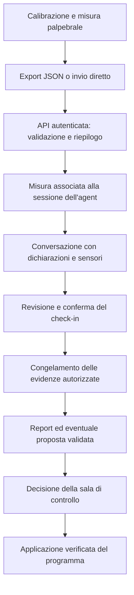

# Integrazione della visione palpebrale con l'agent

Stato: piano da implementare. Responsabili: Tu e Nello. La dashboard di prodotto resta in carico a Fabrizio.

## Obiettivo

Integrare i risultati della visione palpebrale nella conversazione dell'agent e nell'analisi del check-in. L'agent deve confrontare quanto riferito dall'astronauta con sensori e osservazioni palpebrali, chiedere chiarimenti quando opportuno e produrre un report con evidenze verificabili. Le eventuali modifiche del programma richiedono sempre la decisione autorizzata di Terra.

L'integrazione deve funzionare attraverso contratti e API indipendenti dalla dashboard, sia con input testuale sia con quello vocale già implementato.

## Situazione attuale verificata

- L'agent dispone di conversazione, check-in revisionati, conferma e condivisione delle osservazioni, report operativo, diario privato e componenti vocali.
- `ConversationContext` contiene messaggi, sensori, programma e check-in precedenti; non contiene ancora osservazioni palpebrali.
- `SensorReadingSchema` rappresenta soltanto durata del sonno, risvegli e frequenza cardiaca simulati. Non è adatto a contenere la sessione palpebrale completa.
- `ArtifactService` costruisce il contesto operativo dalle osservazioni condivise e dai sensori; verifica i riferimenti generati dall'AI. Va esteso alle nuove evidenze.
- La generazione delle proposte nel runtime richiede ancora il collegamento a un programma autorevole e versionato. È una dipendenza distinta dall'acquisizione palpebrale.
- Il prototipo `feature-visione-palpebrale/vision-prototype` include webcam, MediaPipe locale, calibrazione, motore temporale e JSON `crewready-session-v2`.
- `parseSessionExport` verifica il pacchetto e ne controlla la coerenza rieseguendo il motore. La verifica non autentica l'origine fisica del dato.
- Il collaudo con webcam reale e la validazione quantitativa su persone risultano ancora aperti nella documentazione del prototipo.
- La cartella palpebrale è registrata nella repo principale come gitlink senza `.gitmodules` e contiene modifiche locali non committate. La distribuzione dei sorgenti va resa riproducibile prima di introdurre dipendenze tra i progetti.

Riferimenti:

- [Piano generale dell'agent](AGENT_FEATURE_PLAN.md).
- [Contratti dell'agent](server/agent/contracts/context.ts).
- [Servizio conversazione](server/agent/core/conversation-service.ts).
- [Generazione report e diario](server/agent/services/artifacts.ts).
- [Export palpebrale e integrazione](feature-visione-palpebrale/vision-prototype/docs/integration.md).
- [Guida per incorporare la pipeline](feature-visione-palpebrale/vision-prototype/docs/integrare-componente.md).

## Flusso previsto

Il primo incremento usa l'export JSON esistente. Il secondo aggiunge l'invio diretto dalla pipeline alla stessa API. L'assenza della misura deve consentire di proseguire il check-in, mostrando che l'evidenza palpebrale non è disponibile.

## Contratto proposto

Introdurre `VisionObservation` come tipo dedicato e versionato. Il modello definitivo viene fissato in I0.

| Gruppo | Contenuto previsto |
| --- | --- |
| Identità | ID server, astronauta ricavato dall'autenticazione, sessione agent |
| Provenienza | Versioni export/contratto/motore, origine webcam o sintetica, digest del contenuto importato |
| Tempi | Inizio e fine della misura, acquisizione sul server e data di esportazione |
| Metriche | Copertura, tempo valido, quota di chiusura bilaterale, episodi completi/incompleti/prolungati, durata massima completa |
| Qualità | Stato di utilizzabilità, motivi, interruzione, riferimenti alle calibrazioni e alla configurazione |
| Collegamento | Associazione al check-in e selezione esplicita per il contesto operativo |

Regole del contratto:

- Leggere le metriche dall'istantanea verificata del motore, senza ricalcolarle nel frontend o nell'LLM.
- Conservare unità e valori `null`; assenza di una misura e zero osservato hanno significati diversi.
- Derivare i tempi della webcam dall'origine Unix e dai timestamp monotoni della misura; `exportedAt` non è la data di acquisizione.
- I replay sintetici hanno tempo virtuale: possono alimentare la demo con una collocazione temporale esplicita, senza presentarsi come misure reali.
- Mantenere separati validità strutturale, utilizzabilità per l'analisi e autenticità della sorgente. Un digest serve alla deduplicazione, non prova chi abbia effettuato la misura.
- Le soglie di durata minima, copertura e freschezza sono configurazioni applicative documentate, non soglie diagnostiche né decisioni del modello.

API iniziali proposte:

| Operazione | Endpoint proposto | Comportamento |
| --- | --- | --- |
| Importazione | `POST /api/agent/v1/sessions/{sessionId}/vision-observations` | Valida un export v2, assegna l'identità e restituisce un riepilogo persistito |
| Recupero | `GET /api/agent/v1/sessions/{sessionId}/vision-observations` | Restituisce riepiloghi accessibili all'astronauta proprietario |
| Selezione | Estensione della revisione/conferma del check-in | Seleziona la misura e autorizza il suo eventuale uso operativo con controllo di revisione |

Il caricamento usa JSON v2; la conferma estesa sarà `POST /api/agent/v2/check-ins/{id}/confirm`. Formato, limiti e compatibilità sono fissati in [vision-i0.md](docs/agent/vision-i0.md).

## Regole di analisi, condivisione e persistenza

1. L'osservazione palpebrale descrive il comportamento degli occhi durante una misura. Non determina le ore dormite o un punteggio clinico di stanchezza.
2. Dichiarazioni e misure restano distinguibili. Una divergenza può generare una domanda di approfondimento; non sostituisce automaticamente il dato dichiarato.
3. Una misura insufficiente, interrotta o vecchia conserva le proprie limitazioni e non diventa un risultato rassicurante.
4. Si associa esplicitamente una misura alla sessione/check-in. Più misure non vengono aggregate automaticamente e il report non sceglie autonomamente l'ultima disponibile.
5. Il backend conserva il riepilogo immutabile e i metadati necessari a riferimenti e deduplicazione. L'eventuale conservazione dell'export completo va decisa in I0; il percorso iniziale non richiede video o immagini.
6. Alla conferma si congela il contesto operativo autorizzato, inclusi la misura selezionata e i sensori utilizzati. I tentativi successivi di generazione usano quel contesto, anche se arrivano nuovi dati.
7. Il report e la proposta ricevono soltanto osservazioni condivise e misura autorizzata. Non riportano deduzioni ottenute da contenuti privati esclusi dal contesto operativo.
8. Il diario continua a usare il proprio percorso privato; l'integrazione iniziale non gli aggiunge automaticamente dati palpebrali.
9. Nuove evidenze successive alla conferma richiedono un nuovo check-in. Non modificano retroattivamente gli artefatti pubblicati.

## Task e responsabilità

### I0 — Contratti e decisioni comuni — Tu + Nello

Dipendenza: analisi dei due moduli già eseguita. Prerequisito degli altri task.

Stato: contratto, parametri iniziali e versione API fissati in [docs/agent/vision-i0.md](docs/agent/vision-i0.md). La revisione v2 del prototipo include modifiche locali non pubblicate: I0 resta aperto fino a una revisione riproducibile e alla verifica da checkout pulito.

- [ ] Definire `VisionObservation`, stato di utilizzabilità, riferimenti `vision` ed errori.
- [ ] Fissare formato del caricamento e limiti di byte, campioni e tempo di elaborazione del parser sincrono.
- [x] Fissare durata minima, copertura e freschezza come parametri sperimentali configurabili.
- [ ] Definire conversione dei tempi, trattamento dei replay sintetici e selezione fra più misure.
- [ ] Definire selezione/condivisione nella revisione e conferma del check-in, congelamento del contesto e conservazione dei dati.
- [x] Pianificare la versione dei contratti API e la lettura degli artefatti storici senza evidenze palpebrali.
- [ ] Concordare una distribuzione riproducibile del codice palpebrale: cartella ordinaria o submodule configurato, preservando prima le modifiche locali.
- [ ] Separare i moduli TypeScript puri necessari al server da webcam, React, Vite e asset MediaPipe; fissare la revisione integrata.
- [ ] Preparare esempi validi, insufficienti e sintetici condivisi da entrambi gli sviluppatori.

Completato quando Tu e Nello possono implementare sui medesimi contratti e un checkout pulito recupera tutte le dipendenze necessarie.

### I1 — API, validazione e persistenza — Nello

Dipendenza: I0.

Implementazione: [guida I1](docs/agent/i1-vision-import.md). Il parser usa una copia versionata dei moduli puri; la pubblicazione della revisione del progetto palpebrale e la sostituzione della copia restano da completare in I0.

- [x] Aggiungere modelli Prisma e metodi per riepiloghi, selezione e deduplicazione.
- [x] Implementare caricamento limitato e validazione con il parser del prototipo, verificando versione e coerenza del motore.
- [x] Implementare la conversione dall'export al contratto agent, preservando metriche, tempi e limitazioni.
- [x] Implementare importazione e recupero dei riepiloghi con identità server e controlli sulla sessione.
- [x] Gestire duplicati, conflitti di idempotenza, sessioni concluse, file malformati e limiti di elaborazione.
- [x] Estendere revisione e conferma del check-in per selezione e condivisione con controllo atomico della revisione.
- [x] Persistire il contesto operativo congelato insieme alla conferma; consentire anche conferme senza misura.
- [x] Verificare la compatibilità dei check-in già esistenti, trattando quelli senza snapshot come storici non rigenerabili.

Completato quando una misura importata è persistita, recuperabile e selezionabile soltanto dal proprietario, e la conferma ne fissa l'uso operativo in modo riproducibile.

### I2 — Conversazione e incrocio delle evidenze — Tu

Dipendenza: I0. Può iniziare con provider e repository simulati mentre Nello sviluppa I1.

Implementazione con lettore sostituibile e casi simulati: [I2 — visione nella conversazione](docs/agent/i2-vision-conversation.md). Il runtime usa un lettore vuoto fino al collegamento con I1.

- [x] Aggiungere un'interfaccia di lettura delle osservazioni palpebrali e collegarla al runtime attraverso un adattatore.
- [x] Estendere `ConversationContext` con il riepilogo selezionato, rispettando i limiti del contesto.
- [x] Aggiornare istruzioni e provider Nemotron e simulato per distinguere dichiarazioni, sensori e visione.
- [x] Gestire misure mancanti, insufficienti, vecchie e sintetiche con risposte comprensibili.
- [x] Aggiungere approfondimenti in caso di apparente divergenza, senza creare osservazioni auto-riferite dai dati della webcam.
- [x] Mantenere identico il comportamento per messaggi vocali e testuali.

Completato quando la misura influenza le domande dell'agent senza alterare la provenienza delle risposte dell'astronauta e senza impedire il percorso privo di misura.

### I3 — Report, evidenze e proposta — Nello

Dipendenze: I0 e I1; coordinamento con I2 per i provider AI condivisi.

Implementazione: [guida I3](docs/agent/i3-vision-report.md). La generazione delle proposte rimane disattivata nel runtime fino al collegamento del programma autorevole.

- [x] Estendere `OperationalContext`, `FindingSchema` e i riferimenti alle evidenze con la fonte `vision`.
- [x] Usare il contesto congelato alla conferma durante generazione e tentativi successivi.
- [x] Aggiornare il provider operativo per produrre risultati, divergenze e incertezze con riferimenti verificabili.
- [x] Validare nel backend l'esistenza e l'autorizzazione di ogni evidenza palpebrale citata nel report e nella proposta.
- [x] Documentare qualità, intervallo osservato e origine sintetica dove rilevanti per l'interpretazione del report.
- [x] Verificare l'assenza di contenuti privati non condivisi nel contesto operativo.
- [x] Mantenere esplicita la dipendenza dal programma autorevole per la generazione delle proposte.

Completato quando il report usa esclusivamente evidenze autorizzate e stabili, e nessuna proposta può essere applicata prima della decisione di Terra e della verifica di versione del programma.

### I4 — Prova indipendente tramite importazione — Tu

Dipendenze: I1 e I2. Estensione tecnica della demo, coordinata con T4 del piano generale.

Implementazione: [guida I4](docs/agent/i4-vision-demo.md). Il collaudo visivo e con webcam reale rimane in I6.

- [x] Aggiungere alla pagina di prova caricamento dell'export e riepilogo del risultato.
- [x] Mostrare misura selezionata, copertura, durata valida, origine e motivi di indisponibilità.
- [x] Consentire la scelta della misura e della sua condivisione prima della conferma del check-in.
- [x] Gestire attesa, errori, invio ripetuto e assenza del file; mantenere disponibili testo e voce.
- [ ] Preparare e verificare con webcam reale i casi utilizzabile e insufficiente; il replay sintetico è disponibile nel prototipo.

Completato quando è possibile dimostrare l'incrocio dei dati con un file esportato senza dipendere dalla dashboard di Fabrizio.

### I5 — Invio diretto dalla feature palpebrale — Tu

Dipendenza: percorso tramite export I1–I4 verificato.

Implementazione: [guida I5](docs/agent/i5-direct-vision.md). La prova con dispositivi reali e la pubblicazione della revisione del submodule restano aperte.

- [x] Aggiungere al prototipo un adattatore che invii il pacchetto alla stessa API dopo una misura, su azione esplicita.
- [x] Esporre all'app ospite associazione alla sessione e callback del risultato, mantenendo le credenziali sotto il controllo dell'host.
- [x] Prevedere azione esplicita, stato d'invio e ripetizione idempotente dopo errori di rete.
- [ ] Verificare nel browser endpoint, origine e autenticazione con Vite e Next.js in esecuzione separata; i controlli automatici del bridge e delle API passano.
- [ ] Verificare chiusura risorse, cambio webcam, sospensione e nuova calibrazione durante l'uso combinato con la voce.
- [x] Documentare il riuso dell'adattatore nella futura dashboard.

Completato quando una misura raggiunge l'agent senza download e caricamento manuale e produce lo stesso riepilogo del percorso export.

### I6 — Verifica e consegna — Tu + Nello

Dipendenze: I1–I5; prove della proposta completa subordinate al programma autorevole.

- [ ] Eseguire test di contratto, conversione e compatibilità dei dati storici.
- [ ] Verificare controlli di proprietà, condivisione, sessioni confermate, duplicati e richieste concorrenti.
- [ ] Verificare il rifiuto di export incoerenti, versioni sconosciute e payload oltre i limiti.
- [ ] Verificare misura valida, nessun tempo valido, bassa copertura, interruzione, misura vecchia e replay sintetico.
- [ ] Verificare che nessun dato palpebrale diventi automaticamente un valore dichiarato di sonno o stanchezza.
- [ ] Verificare che un nuovo caricamento non modifichi report e proposte già generati o il contesto di un tentativo successivo.
- [ ] Verificare che riferimenti inesistenti o non condivisi generati dall'AI vengano rifiutati.
- [ ] Eseguire test pertinenti, lint, TypeScript e build dei progetti coinvolti.
- [ ] Eseguire il percorso pratico con webcam e microfono reali, distinguendolo dai test sintetici.
- [ ] Aggiornare la guida API per Fabrizio con payload, risposte, errori, autenticazione e un esempio completo.

Completato quando il flusso è riproducibile da checkout pulito e Fabrizio può collegarlo senza modificare il nucleo dell'agent.

## Ordine di lavoro

1. Chiudere I0, inclusa la distribuzione dei sorgenti palpebrali.
2. Nello procede con I1; Tu sviluppi I2 usando fixture e adattatori simulati.
3. Collegare I1 e I2; Nello procede con I3 e Tu con I4.
4. Verificare il percorso completo tramite export prima di iniziare I5.
5. Eseguire I6 e consegnare i contratti a Fabrizio.

Nello mantiene le modifiche a Prisma, repository e conferma del check-in. Le variazioni a contratti condivisi, runtime e provider AI vanno concordate prima di lavorare sugli stessi file. Ogni task può diventare una issue o PR con il proprio identificativo nel titolo.

## Criteri finali di accettazione

- L'agent usa la misura associata al check-in e ne conosce tempi, origine e limitazioni.
- Testo e voce attraversano gli stessi servizi applicativi.
- La mancanza di una misura non blocca la conversazione.
- L'astronauta può controllare quali evidenze entrano nell'analisi operativa condivisa.
- Report e proposta citano soltanto riferimenti autorizzati e restano riproducibili dopo nuovi caricamenti.
- Le misure sperimentali non vengono presentate come diagnosi o accuratezza già validata.
- Il programma cambia soltanto dopo una decisione autorizzata e un'applicazione verificata.
- Importazione e invio diretto usano il medesimo contratto, riutilizzabile dalla dashboard.
