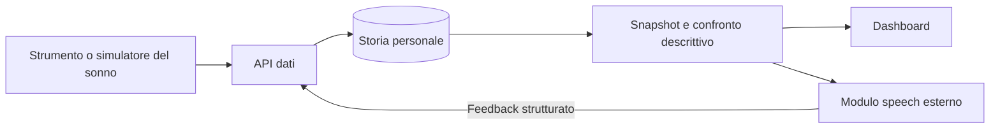

# Dati dell'astronauta e contratto con il modulo speech

## Perimetro

Il sistema informativo operativo si basa sui dati personali dell'astronauta, con il sonno come dimensione principale. I dataset NASA restano fonti di ricerca e non sostituiscono le sue osservazioni. In demo, strumenti e feedback possono essere simulati con `synthetic: true`.

Questo backend riceve e organizza dati. **Non implementa audio, STT, TTS, estrazione dal parlato o agente conversazionale:** sono responsabilità del modulo esterno del compagno del team.

## Flusso



Il feedback può arrivare a ogni turno utile. Non ogni frammento audio deve produrre un'osservazione: il modulo esterno assegna un identificativo stabile all'evento ed esplicita che cosa ha raccolto. Rispedire lo stesso `observation_id` restituisce 409, senza duplicare. La correzione di una vecchia osservazione non è ancora implementata: non simulare una rettifica inviando silenziosamente record contraddittori.

## Ingresso da strumento

`POST /v1/observations`, tipo `sleep_measurement`: durata stimata, dispositivo, metodo e intervallo di osservazione. I campi sono mostrati nell'OpenAPI. Il backend verifica che la durata sia compatibile con l'intervallo e che il timestamp non preceda la fine della misura.

È un riepilogo di un episodio del sonno, non un'implementazione del sensore o del suo algoritmo. `quality=valid` è dichiarato dal produttore: non certifica precisione clinica. Non inventare una scala di qualità del sonno a partire dalla sola durata.

## Ingresso dal modulo speech

`POST /v1/speech-feedback` riceve JSON e restituisce l'osservazione registrata e il contesto aggiornato per il compagno. Non accetta file audio.

```json
{
  "kind": "speech_feedback",
  "observation_id": "speech-event-0001",
  "subject_id": "crew-1",
  "observed_at": "2026-11-14T09:00:00Z",
  "synthetic": true,
  "turn_id": "turn-0001",
  "basis": "self_report",
  "user_confirmed": true,
  "fatigue_rating": 8,
  "alertness": 4
}
```

I valori di esempio sono sintetici. Il produttore usa `synthetic=false` solo per osservazioni effettivamente raccolte dal soggetto.

- `fatigue_rating`: intero 1–10, da minima a massima fatica riferita.
- `alertness`: intero 1–10, da minima a massima vigilanza percepita.
- `mood_rating`: intero 1–10, da molto negativo a molto positivo; `mood_scale_max` distingue la scala per i dati nuovi.
- Almeno una scala deve essere presente; le altre rimangono assenti.
- `basis=self_report`: valore espresso dall'utente. `user_confirmed=true` richiede che quel valore e la sua attribuzione siano stati confermati; il backend non può verificarlo dall'audio.
- `basis=model_inference`: ipotesi del modulo esterno, sempre con `user_confirmed=false`. Resta nello storico ma non viene promossa a dichiarazione confermata nel contesto.

Sono scale prototipali definite per il contratto, non strumenti psicometrici validati. «Sono molto stanco» non autorizza ad assegnare arbitrariamente un 8: il modulo esterno deve chiedere o confermare la scala; in alternativa non invia quel valore numerico. Non viene implementata qui una classificazione automatica delle emozioni.

## Incrocio e uscita

Snapshot e `agent-context` includono `sleep_context`:

- Ultima misura strumentale valida del sonno, con provenienza e orari.
- Ultimo feedback valido, espresso e confermato dall'utente.
- Riferimento personale dimostrativo dalla mediana di 3–5 episodi precedenti dello stesso dispositivo e metodo, non sovrapposti all'episodio corrente.
- Differenza in ore rispetto al riferimento, oppure `insufficient_data`.
- Allineamento temporale: il feedback segue la fine del sonno entro 24 ore, oppure appartiene a periodi diversi. La finestra è una regola esplorativa dichiarata.

Il sistema può quindi fornire all'agente due fatti distinti: «5,5 ore stimate dallo strumento» e «fatica 8/10 riferita dall'utente». Non conclude da solo che il sonno abbia causato stanchezza. `fatigue_diagnosis` resta nullo.

Le misure mantengono i timestamp: un dato vecchio non dimostra lo stato attuale. Lo snapshot non esegue una diagnosi o una certificazione di idoneità. Dati mancanti, invalidi, inferiti e sintetici restano distinguibili.

## Prova locale

Da `server/`, dopo l'installazione:

```powershell
.\.venv\Scripts\python.exe -m aegis_data import examples/sleep_and_feedback.json
```

Aprire `/v1/subjects/demo-astronaut/agent-context?synthetic=true`. Il file contiene un episodio e un feedback: il riferimento personale è correttamente insufficiente. I precedenti esempi e i nuovi tipi possono convivere nell'archivio.

Le API restano locali e senza autenticazione: identità del soggetto e conferma sono responsabilità dell'applicazione fidata. Prima di collegamenti remoti servono autenticazione e autorizzazione lato server.
