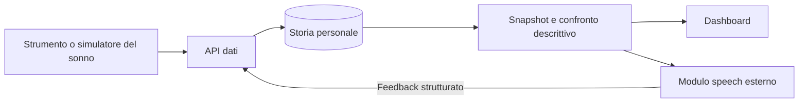

# Astronaut data and speech module contract

## Scope

The operational information system is based on astronaut personal data, with sleep as the primary dimension. NASA datasets remain research sources and do not replace his observations. In demo, tools and feedback can be simulated with `synthetic: true`.

This backend receives and organizes data. **It does not implement audio, STT, TTS, speech extraction, or conversational agent:** these are the responsibility of the external team companion module.

## Flow



Feedback can arrive at every useful turn. Not every audio fragment must produce an observation: the external module assigns a stable identifier to the event and explicitly states what it collected. Resending the same `observation_id` returns 409, without duplicating. Correction of an old observation is not yet implemented: do not simulate a correction by silently sending contradictory records.

## Tool input

`POST /v1/observations`, type `sleep_measurement`: estimated duration, device, method, and observation interval. Fields are shown in OpenAPI. The backend verifies that duration is compatible with the interval and that the timestamp does not precede the end of the measurement.

It is a summary of a sleep episode, not an implementation of the sensor or its algorithm. `quality=valid` is declared by the manufacturer: it does not certify clinical accuracy. Do not invent a sleep quality scale based solely on duration.

## Speech module input

`POST /v1/speech-feedback` receives JSON and returns the recorded observation and the updated context for the companion. It does not accept audio files.

```json
{
  "kind": "speech_feedback",
  "observation_id": "speech-event-0001",
  "subject_id": "crew-1",
  "observed_at": "2026-11-14T09:00:00Z",
  "synthetic": true,
  "turn_id": "turn-0001",
  "basis": "self_report",
  "user_confirmed": true,
  "fatigue_rating": 8,
  "alertness": 4
}
```

Example values are synthetic. The producer uses `synthetic=false` only for observations actually collected from the subject.

- `fatigue_rating`: integer 1–10, from minimum to maximum reported fatigue.
- `alertness`: integer 1–10, from minimum to maximum perceived alertness.
- `mood_rating`: integer 1–10, from very negative to very positive; `mood_scale_max` distinguishes the scale for new data.
- At least one scale must be present; the others remain absent.
- `basis=self_report`: value expressed by the user. `user_confirmed=true` requires that the value and its attribution have been confirmed; the backend cannot verify this from audio.
- `basis=model_inference`: hypothesis of the external module, always with `user_confirmed=false`. It remains in history but is not promoted to a confirmed statement in the context.

These are prototype scales defined for the contract, not validated psychometric instruments. «I am very tired» does not authorize arbitrarily assigning an 8: the external module must ask or confirm the scale; alternatively, it does not send that numeric value. Automatic emotion classification is not implemented here.

## Cross-reference and output

Snapshot and `agent-context` include `sleep_context`:

- Last valid instrumental sleep measurement, with provenance and times.
- Last valid feedback, expressed and confirmed by the user.
- Demonstrative personal reference from the median of 3–5 previous episodes of the same device and method, not overlapping the current episode.
- Difference in hours compared to the reference, or `insufficient_data`.
- Temporal alignment: feedback follows the end of sleep within 24 hours, or belongs to different periods. The window is a declared exploratory rule.

The system can therefore provide the agent with two distinct facts: «5.5 hours estimated by the instrument» and «fatigue 8/10 reported by the user». It does not conclude by itself that sleep caused fatigue. `fatigue_diagnosis` remains null.

Measurements keep their timestamps: an old datum does not demonstrate current state. The snapshot does not perform a diagnosis or fitness certification. Missing, invalid, inferred, and synthetic data remain distinguishable.

## Local test

From `server/`, after installation:

```powershell
.\.venv\Scripts\python.exe -m aegis_data import examples/sleep_and_feedback.json
```

Open `/v1/subjects/demo-astronaut/agent-context?synthetic=true`. The file contains an episode and a feedback: the personal reference is correctly insufficient. Previous examples and new types can coexist in the archive.

APIs remain local and without authentication: subject identity and confirmation are the responsibility of the trusted application. Before remote connections, server-side authentication and authorization are required.
