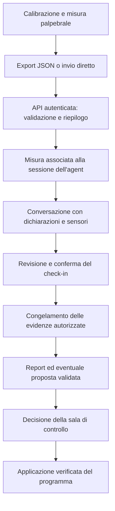

# Eyelid vision integration with the agent

Status: implementation plan. Responsible: You and Nello. The product dashboard remains with Fabrizio.

## Objective

Integrate eyelid vision results into the agent conversation and check-in analysis. The agent must compare what the astronaut reports with sensors and eyelid observations, ask for clarifications when appropriate, and produce a report with verifiable evidence. Any program changes always require an authorized decision from Terra.

Integration must work through contracts and APIs independent of the dashboard, with both text input and already implemented voice input.

## Verified current situation

- The agent has conversation, reviewed check-ins, confirmation and sharing of observations, operational report, private diary, and voice components.
- `ConversationContext` contains messages, sensors, program, and previous check-ins; it does not yet contain eyelid observations.
- `SensorReadingSchema` represents only sleep duration, awakenings, and simulated heart rate. It is not suitable for containing the full eyelid session.
- `ArtifactService` builds the operational context from shared observations and sensors; it verifies AI-generated references. It must be extended to the new evidence.
- Runtime proposal generation still requires connection to an authoritative and versioned program. It is a dependency distinct from eyelid acquisition.
- The prototype `feature-visione-palpebrale/vision-prototype` includes webcam, local MediaPipe, calibration, time engine, and JSON `crewready-session-v2`.
- `parseSessionExport` verifies the package and checks its consistency by re-running the engine. Verification does not authenticate the physical origin of the data.
- Real webcam testing and quantitative validation on people are still open in the prototype documentation.
- The eyelid folder is registered in the main repo as a gitlink without `.gitmodules` and contains uncommitted local changes. Source distribution must be made reproducible before introducing dependencies between projects.

References:

- [Agent general plan](AGENT_FEATURE_PLAN.md).
- [Agent contracts](../../server/agent/contracts/context.ts).
- [Conversation service](../../server/agent/core/conversation-service.ts).
- [Report and diary generation](../../server/agent/services/artifacts.ts).
- [Eyelid export and integration](../../feature-visione-palpebrale/vision-prototype/docs/integration.md).
- [Pipeline incorporation guide](../../feature-visione-palpebrale/vision-prototype/docs/integrare-componente.md).

## Expected flow

The first increment uses the existing JSON export. The second adds direct sending from the pipeline to the same API. The absence of the measurement must allow the check-in to proceed, showing that eyelid evidence is not available.

## Proposed contract

Introduce `VisionObservation` as a dedicated and versioned type. The final model is fixed in I0.

| Group | Expected content |
| --- | --- |
| Identity | Server ID, astronaut derived from authentication, agent session |
| Provenance | Export/contract/engine versions, webcam or synthetic origin, digest of imported content |
| Times | Start and end of measurement, server acquisition, export date |
| Metrics | Coverage, valid time, bilateral closure rate, complete/incomplete/prolonged episodes, maximum complete duration |
| Quality | Usability status, reasons, interruption, references to calibrations and configuration |
| Link | Association to check-in and explicit selection for operational context |

Contract rules:

- Read metrics from the verified engine snapshot, without recalculating them in the frontend or LLM.
- Preserve units and `null` values; absence of a measurement and zero observed value have different meanings.
- Derive webcam times from Unix origin and monotonic measurement timestamps; `exportedAt` is not the acquisition date.
- Synthetic replays have virtual time: they can feed the demo with an explicit temporal placement, without presenting themselves as real measurements.
- Keep structural validity, usability for analysis, and source authenticity separate. A digest serves for deduplication, not to prove who performed the measurement.
- Minimum duration, coverage, and freshness thresholds are documented application configurations, not diagnostic thresholds nor model decisions.

Proposed initial APIs:

| Operation | Proposed endpoint | Behavior |
| --- | --- | --- |
| Import | `POST /api/agent/v1/sessions/{sessionId}/vision-observations` | Validates a v2 export, assigns identity, and returns a persisted summary |
| Retrieval | `GET /api/agent/v1/sessions/{sessionId}/vision-observations` | Returns summaries accessible to the owning astronaut |
| Selection | Extension of check-in review/confirmation | Selects the measurement and authorizes its eventual operational use with revision control |

Upload uses JSON v2; extended confirmation will be `POST /api/agent/v2/check-ins/{id}/confirm`. Format, limits, and compatibility are fixed in [vision-i0.md](../agent/vision-i0.md).

## Analysis, sharing, and persistence rules

1. Eyelid observation describes eye behavior during a measurement. It does not determine sleep hours or a clinical fatigue score.
2. Statements and measurements remain distinguishable. A divergence can generate a clarification question; it does not automatically replace the declared data.
3. An insufficient, interrupted, or old measurement retains its limitations and does not become a reassuring result.
4. A measurement is explicitly associated with a session/check-in. Multiple measurements are not automatically aggregated and the report does not autonomously select the last available one.
5. The backend stores the immutable summary and metadata necessary for references and deduplication. Whether to store the full export is decided in I0; the initial path does not require video or images.
6. At confirmation, the authorized operational context is frozen, including the selected measurement and sensors used. Subsequent generation attempts use that context, even if new data arrives.
7. The report and proposal receive only shared observations and authorized measurement. They do not report deductions obtained from private content excluded from the operational context.
8. The diary continues to use its own private path; initial integration does not automatically add eyelid data to it.
9. New subsequent evidence after confirmation requires a new check-in. It does not retroactively modify published artifacts.

## Tasks and responsibilities

### I0 — Contracts and common decisions — You + Nello

Dependency: analysis of the two modules already performed. Prerequisite for other tasks.

Status: contract, initial parameters, and API version fixed in [docs/agent/vision-i0.md](../agent/vision-i0.md). The v2 revision sources of origin `9803a5f41eff521db5d1305af82323da11332eb5` are included directly in `feature-visione-palpebrale/`; the 20 parser modules copied into the backend coincide with that revision.

- [ ] Define `VisionObservation`, usability status, `vision` references, and errors.
- [ ] Fix upload format and byte, sample, and synchronous parser processing time limits.
- [x] Fix minimum duration, coverage, and freshness as configurable experimental parameters.
- [ ] Define time conversion, synthetic replay handling, and selection among multiple measurements.
- [ ] Define selection/sharing in check-in review and confirmation, context freezing, and data retention.
- [x] Plan API contract versioning and reading historical artifacts without eyelid evidence.
- [x] Fix reproducible distribution with sources and assets included in the main repo, preserving the integrated revision.
- [x] Separate pure TypeScript modules needed by the server from webcam, React, Vite, and MediaPipe assets; fix the integrated revision.
- [ ] Prepare valid, insufficient, and synthetic examples shared by both developers.

Completed when You and Nello can implement on the same contracts and a clean checkout retrieves all necessary dependencies.

### I1 — API, validation, and persistence — Nello

Dependency: I0.

Implementation: [I1 guide](../agent/i1-vision-import.md). The parser uses a versioned copy of pure modules, compared with the integrated revision in the eyelid folder.

- [x] Add Prisma models and methods for summaries, selection, and deduplication.
- [x] Implement limited upload and validation with the prototype parser, verifying version and engine consistency.
- [x] Implement conversion from export to agent contract, preserving metrics, times, and limitations.
- [x] Implement import and retrieval of summaries with server identity and session checks.
- [x] Handle duplicates, idempotency conflicts, concluded sessions, malformed files, and processing limits.
- [x] Extend check-in review and confirmation for selection and sharing with atomic revision control.
- [x] Persist frozen operational context together with confirmation; allow confirmations without measurement.
- [x] Verify compatibility of existing check-ins, treating those without snapshots as historical non-regenerable.

Completed when an imported measurement is persisted, retrievable, and selectable only by the owner, and confirmation fixes its operational use in a reproducible way.

### I2 — Conversation and evidence cross-check — You

Dependency: I0. Can start with simulated providers and repositories while Nello develops I1.

Implementation with replaceable reader and simulated cases: [I2 — vision in conversation](../agent/i2-vision-conversation.md). The runtime uses an empty reader until connection with I1.

- [x] Add an eyelid observation reading interface and connect it to the runtime through an adapter.
- [x] Extend `ConversationContext` with the selected summary, respecting context limits.
- [x] Update instructions and Nemotron and simulated providers to distinguish statements, sensors, and vision.
- [x] Handle missing, insufficient, old, and synthetic measurements with understandable responses.
- [x] Add clarifications in case of apparent divergence, without creating self-referential observations from webcam data.
- [x] Keep behavior identical for voice and text messages.

Completed when the measurement influences agent questions without altering the provenance of astronaut responses and without preventing the measurement-free path.

### I3 — Report, evidence, and proposal — Nello

Dependencies: I0 and I1; coordination with I2 for shared AI providers.

Implementation: [I3 guide](../agent/i3-vision-report.md). Proposal generation remains disabled in runtime until connection to the authoritative program.

- [x] Extend `OperationalContext`, `FindingSchema`, and evidence references with the `vision` source.
- [x] Use the frozen context at confirmation during generation and subsequent attempts.
- [x] Update the operational provider to produce results, divergences, and uncertainties with verifiable references.
- [x] Validate in the backend the existence and authorization of every eyelid evidence cited in the report and proposal.
- [x] Document quality, observed interval, and synthetic origin where relevant for report interpretation.
- [x] Verify absence of non-shared private content in the operational context.
- [x] Keep explicit the dependency on the authoritative program for proposal generation.

Completed when the report uses exclusively authorized and stable evidence, and no proposal can be applied before Terra's decision and program version verification.

### I4 — Independent proof via import — You

Dependencies: I1 and I2. Technical demo extension, coordinated with T4 of the general plan.

Implementation: [I4 guide](../agent/i4-vision-demo.md). Visual and real webcam testing remains in I6.

- [x] Add export upload and result summary to the test page.
- [x] Show selected measurement, coverage, valid duration, origin, and unavailability reasons.
- [x] Allow measurement selection and sharing before check-in confirmation.
- [x] Handle waiting, errors, repeated sending, and missing file; keep text and voice available.
- [ ] Prepare and verify with real webcam the usable and insufficient cases; synthetic replay is available in the prototype.

Completed when it is possible to demonstrate data cross-checking with an exported file without depending on Fabrizio's dashboard.

### I5 — Direct sending from eyelid feature — You

Dependency: export path I1–I4 verified.

Implementation: [I5 guide](../agent/i5-direct-vision.md). Sources are included in the main repo; real device testing remains documented.

- [x] Add to the prototype an adapter that sends the package to the same API after a measurement, on explicit action.
- [x] Expose to the host app session association and result callback, keeping credentials under host control.
- [x] Provide explicit action, sending status, and idempotent retry after network errors.
- [ ] Verify in browser endpoint, origin, and authentication with Vite and Next.js running separately; automatic bridge and API checks pass.
- [ ] Verify resource closure, webcam change, suspension, and new calibration during combined use with voice.
- [x] Document adapter reuse in the future dashboard.

Completed when a measurement reaches the agent without download and manual upload and produces the same summary as the export path.

### I6 — Verification and delivery — You + Nello

Dependencies: I1–I5; full proposal proof subordinate to authoritative program.

- [ ] Run contract, conversion, and historical data compatibility tests.
- [ ] Verify ownership, sharing, confirmed sessions, duplicates, and concurrent request checks.
- [ ] Verify rejection of inconsistent exports, unknown versions, and payloads beyond limits.
- [ ] Verify valid measurement, no valid time, low coverage, interruption, old measurement, and synthetic replay.
- [ ] Verify that no eyelid data automatically becomes a declared sleep or fatigue value.
- [ ] Verify that a new upload does not modify already generated reports and proposals or the context of a subsequent attempt.
- [ ] Verify that non-existent or non-shared AI-generated references are rejected.
- [ ] Run relevant tests, lint, TypeScript, and build of involved projects.
- [ ] Run the practical path with real webcam and microphone, distinguishing it from synthetic tests.
- [ ] Update Fabrizio's API guide with payloads, responses, errors, authentication, and a complete example.

Completed when the flow is reproducible from a clean checkout and Fabrizio can connect it without modifying the agent core.

## Work order

1. Close I0, including eyelid source distribution.
2. Nello proceeds with I1; You develop I2 using fixtures and simulated adapters.
3. Connect I1 and I2; Nello proceeds with I3 and You with I4.
4. Verify the full path via export before starting I5.
5. Run I6 and deliver contracts to Fabrizio.

Nello maintains changes to Prisma, repositories, and check-in confirmation. Changes to shared contracts, runtime, and AI providers must be agreed before working on the same files. Each task can become an issue or PR with its own identifier in the title.

## Final acceptance criteria

- The agent uses the measurement associated with the check-in and knows times, origin, and limitations.
- Text and voice go through the same application services.
- Lack of a measurement does not block conversation.
- The astronaut can control which evidence enters shared operational analysis.
- Report and proposal cite only authorized references and remain reproducible after new uploads.
- Experimental measurements are not presented as diagnosis or already validated accuracy.
- The program changes only after an authorized decision and verified application.
- Import and direct sending use the same contract, reusable by the dashboard.
