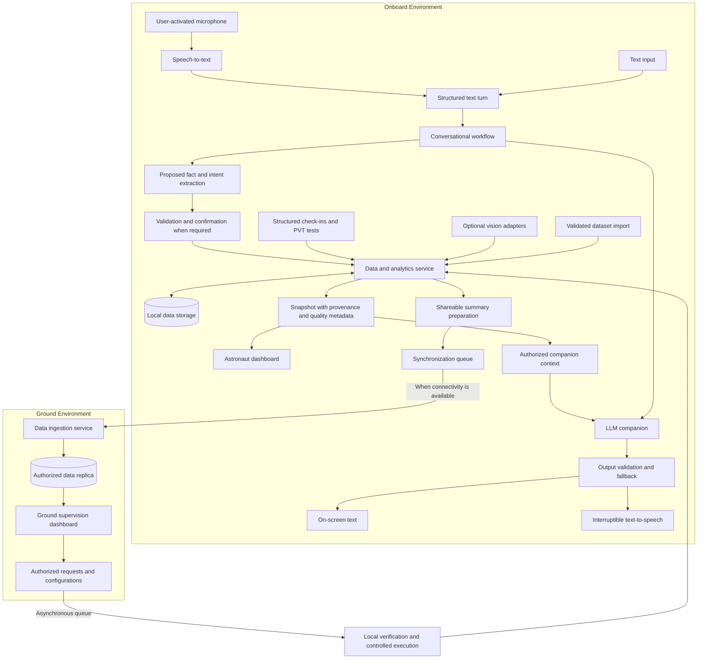

# AEGIS — Proposed Architecture

**Status:** Architectural design proposal, not yet implemented.

**Date:** November 14, 2026 · [Product Vision](docs/PROJECT.md) · [Scientific Foundation](docs/SCIENTIFIC_FOUNDATION.md)

## 1. Core Architectural Decision

AEGIS integrates **sleep monitoring, reaction time assessment, and self-reported mood tracking** with a voice- and text-based companion. The initial version prioritizes contextual conversation, data collection, and dashboard visualization. Activity recommendations and their associated catalog are deferred to a second development phase.

This prioritization reflects the team's latest decision and supersedes the previous MVP roadmap outlined in `PROJECT.md`, which included activities in the initial demonstration.

**The conversational agent and the dashboard consume data from the same structured data service.** The dashboard visualizes information; it does not organize or process data on behalf of the agent. Conversely, the agent is not required to calculate metrics or update charts.

The original proposal to separate conversational responsibilities from data management remains valid from an architectural perspective. However, this separation does not require two independent LLMs. The initial implementation will consist of a conversational agent, a deterministic data service, and, only if justified, an optional LLM module for translating natural-language questions into structured requests.

## 2. High-Level System Architecture

The diagram represents logical responsibilities rather than mandatory deployment boundaries. For the MVP, several components can coexist within the same backend. There is no need to introduce a separate microservice for every architectural block.

## 3. Voice Interface and Conversational Agent

Voice interaction consists of three distinct stages:

1. **Speech-to-Text (STT):** Converts spoken audio into text. This component does not perform the companion's reasoning.

2. **Serialization and Validation:** The backend constructs a structured message containing user, session, and turn identifiers, timestamps, language, input source, and transcription. Quality indicators are included only when available.

3. **Conversation:** The conversational workflow interprets the request, retrieves the required context, and generates a response, which is displayed as text and subsequently synthesized through TTS.

A properly serialized message may still contain transcription errors. Ambiguous numerical values, negations, and temporal references require clarification. For example, the phrase "five hours" must not automatically become a recorded sleep measurement unless the system can establish which night the astronaut is referring to.

The companion can listen, ask follow-up questions, explain verified information, and help users navigate their results. It must remain capable of carrying out conversations without waiting for every system module and must explicitly acknowledge unavailable data.

Simple requests should not necessarily require invoking a second LLM.

### Mood Tracking

Conversation may produce a proposed self-reported mood observation, such as "I feel tense," linked to the originating conversational turn and correctable by the astronaut.

**Model-generated interpretations must remain distinct from confirmed self-reports.**

Emotion recognition based on voice, facial expressions, or linguistic patterns is considered an experimental extension, not an established reliable measurement mechanism within the MVP.

Explicit microphone activation, response interruption, silent mode, and text-based interaction are essential features of the primary user experience.

Raw audio should not be retained by default. Separate retention policies must be established for transcripts and conversational memory.

## 4. Responsibilities of the Data Service

The component initially described as the "data agent" should be divided into two categories of responsibility: deterministic data processing and optional language-based query interpretation.

| Responsibility | Proposed Implementation |
|---|---|
| Import datasets, normalize units, validate data types and provenance | Ingestion and validation code |
| Store observations, retrieve historical records, and manage corrections | Repository layer and parameterized queries |
| Calculate PVT metrics, baselines, variations, and quality indicators | Versioned deterministic functions |
| Prepare information for dashboards and conversational contexts | Query service with shared schemas |
| Interpret questions such as "How did I sleep this week?" | Optional LLM-based structured query generation |
| Execute queries and enforce authorization and operational constraints | Deterministic backend |

The optional LLM component operates through restricted tools, such as:

- `get_sleep_history`
- `get_vigilance_summary`
- `get_reported_mood`

It must not receive unrestricted SQL access or permission to modify the database directly.

Identity and authorization information must come from the authenticated session rather than identifiers generated or supplied within a prompt.

For the MVP, a single conversational companion can invoke these tools without introducing a separate data agent.

If retrieval requirements become more complex, a second logical agent role may be introduced with its own context and tools, potentially using the same underlying language model.

**The number of agent roles, language models, and running processes represents three independent architectural decisions.**

## 5. Datasets, Storage, and Data Provenance

The term "dataset" must be precisely defined before implementation.

### Data Categories

**1. Public or Research Datasets**

Imported with appropriate licensing information, protocol descriptions, and documented transformations.

These datasets do not represent an astronaut's personal history and must not automatically become their individual baseline.

**2. Personal Observations**

Structured check-ins, test results, and vision-derived signals collected over time.

These observations constitute the operational local data repository.

**3. Synthetic Data**

Fixtures used for demonstrations and testing, explicitly labeled and separated from real observations.

**4. Scientific Documentation**

A potential reference corpus supporting explanations and evidence retrieval, maintained separately from numerical observations.

Document retrieval does not replace structured queries or time-series analytics.

No specific dataset has yet been inspected as part of this architecture. File formats, columns, participant characteristics, temporal coverage, and usage rights remain to be verified.

### Observation Schema

Every observation should contain at least:

- A stable observation identifier.
- Subject identifier.
- Observation type.
- Value and unit or measurement scale.
- Observation timestamp.
- Acquisition timestamp.
- Data source and provenance.
- Quality metadata.
- Confirmation status.
- Real or synthetic data classification.
- Schema version.

Corrections must preserve provenance and must not silently overwrite previously recorded values.

Derived metrics must reference their temporal interval, calculation rule version, and source observations.

**Missing data must not be interpreted as zero. Model-generated hypotheses must not be treated as measurements.**

## 6. Dashboard and Shared Context

The backend exposes a consistent data snapshot containing information such as:

- `snapshot_id`
- `as_of`
- Time interval
- Query parameters
- Quality metadata
- Calculation rule versions

The dashboard displays the structured values, while the conversational companion receives the authorized subset of the same snapshot.

**The intended data flow is:**

`Local Storage → Data Service → Dashboard / Agent Context`

The dashboard must not construct charts by parsing LLM-generated responses.

Similarly, the agent must not inspect screenshots or query frontend application state to determine which observations exist.

User-selected filters can instead be passed to the backend as explicit query parameters.

Updates may rely on polling or backend-generated events.

PVT tests and sensor acquisitions must update persistent storage independently of conversational activity.

If the dashboard and the conversational agent use different snapshots, the system must display their respective update timestamps rather than implying that the information is synchronized.

## 7. Ground Supervision Dashboard

The team has reported that instructors recommended including a ground-based supervision dashboard.

This recommendation is incorporated as a project requirement.

However, **the statement that "NASA requires absolute control" is not treated as a verified official requirement**, nor is it interpreted as authorization for unrestricted access to private conversations.

### Initial Ground Dashboard Features

The initial version provides:

- Authorized summaries of sleep, reaction time, and self-reported mood.
- Historical trends, data quality indicators, and explicitly justified status indicators.
- Service availability, model and rule versions, and last synchronization timestamps.
- Distinction between observation, transmission, and reception times.
- Clear identification of stale, delayed, or incomplete data.
- Auditable histories of requests, configuration changes, and execution outcomes.

The initial ground interface is primarily read-only.

Potential remote actions must be implemented as typed, authorized commands, such as requesting a summary, sending a message, or proposing a configuration change within predefined boundaries.

These actions must not include arbitrary code execution, direct access to onboard databases, or autonomous medical decision-making by the language model.

### Synchronization and Authority

The onboard repository is the authoritative source for personal observations.

The ground environment receives a replica containing only the information permitted by the applicable data-sharing policy.

Synchronization relies on a persistent queue, unique identifiers, acknowledgments, and retry mechanisms designed to prevent duplicate application of messages.

The astronaut must be able to continue using AEGIS without an active network connection.

Every remote command includes:

- Command author.
- Unique command identifier.
- Expected configuration or state version.
- Optional expiration timestamp.

The onboard system verifies authenticity, permissions, compatibility, and whether human confirmation is required.

The ground dashboard must distinguish between the following command states:

`Sent → Received → Applied / Rejected / Expired`

Transmission does not imply successful execution.

### MVP Privacy and Access Policy

The MVP should provide explicitly reviewed shared summaries, separation of private notes, access control, and audit logging.

Any operational requirement involving periodic telemetry or emergency access requires an agreed policy specifying what information is shared, with whom, and under which conditions.

The system must not promise a level of confidentiality that conflicts with its actual data-sharing policy.

## 8. LangChain and LangGraph

**Recommended approach: LangGraph for conversational workflow orchestration and LangChain for LLM integrations, tools, and structured outputs.**

Data processing, analytics, and synchronization remain conventional software components.

Official documentation distinguishes between workflows, which follow predefined execution paths, and agents, which dynamically determine their execution steps.

LangGraph supports combinations of deterministic operations and LLM-based components, including state management, streaming, and interruptions.

LangChain provides model and tool abstractions and integrations, although it is not strictly required to use LangGraph [1, 2].

This approach is appropriate for AEGIS because the system requires explicit, controlled execution paths:

`Transcription → Interpretation → Optional Clarification → Data Retrieval → Response`

Introducing a network of autonomous agents that freely delegate tasks would increase latency and complicate reproducibility, testing, and behavioral verification.

LangChain supports schema-based structured outputs, but **structural validity does not guarantee factual correctness** [3].

Application-level validation is still required for measurement units, acceptable ranges, provenance, and authorization, together with checks ensuring that generated explanations remain consistent with the underlying data.

There is no requirement to use LangGraph or LangChain for STT, TTS, computer vision, or SQLite queries. These components can be invoked directly from workflow nodes.

The actual models must be selected through empirical evaluation of:

- Italian and English language quality.
- Tool-calling reliability.
- Inference latency.
- Memory consumption.
- Performance on the available hardware.

Workflow checkpoints and conversational history constitute sensitive data and must follow the same retention and access policies as other personal records.

Cloud-based tracing and observability services are not mandatory.

The offline demonstration must remain functional without transmitting conversations or personal data to external services.

## 9. Proposed Initial Technology Stack

| Component | Proposed Technology | Status |
|---|---|---|
| Backend and APIs | Python + FastAPI | Proposal pending confirmation against team expertise |
| Schemas and validation | Pydantic | Explicit contracts between components |
| Local storage | SQLite | Suitable starting point for a single workstation |
| Analytics | Testable Python functions | Independent of LLMs and frontend |
| Conversation | LangGraph + LangChain integrations | Constrained workflow with controlled tools |
| LLM, STT, and TTS | Local models to be benchmarked | No model selected or hardware requirements validated |
| Computer vision | Adapters for existing team prototypes | Code, output formats, and performance require verification |
| Frontend | Conversational home interface and dashboard using a shared API | Framework to be agreed upon |
| Ground segment | Ingestion backend and dedicated role-based interface | Replication and asynchronous communication |

For the MVP, the recommended deployment consists of a modular onboard backend and a lightweight ground-side receiver.

A distributed infrastructure, vector database, or dedicated language model for each logical role should not be introduced without a demonstrated technical need.

## 10. Implementation Roadmap and Verification

### Phase 1 — Data Contracts and Dataset Assessment

Inspect the actual dataset files and define measurement units, subject identifiers, provenance, and synthetic data conventions.

### Phase 2 — Deterministic Data Pipeline

Implement structured check-ins and PVT result ingestion.

Calculate a consistent snapshot and display the results through the dashboard.

### Phase 3 — Text-Based Companion

Enable the companion to retrieve snapshots through restricted tools and discuss sleep, reaction time, and self-reported mood.

Implement clarification mechanisms for ambiguous information extraction.

### Phase 4 — Voice Interaction

Integrate STT and TTS, response interruption, and fallback mechanisms.

Measure the latency of each processing stage on the target device.

### Phase 5 — Ground Synchronization

Transfer an authorized summary to the ground receiver.

Demonstrate delayed delivery, temporary disconnection, and repeated message reception without duplicate application.

### Phase 6 — Computer Vision Integration

Integrate only well-defined, verifiable outputs from the team's computer vision prototypes.

Expose quality indicators and explicitly represent unavailable observations.

### Phase 7 — Contextual Activities (Second Development Phase)

Introduce a reviewed activity catalog, optional contextual recommendations, and user feedback collection.

### Critical Verification Criteria

The architecture must demonstrate that:

1. The dashboard and conversational companion can consume the same data snapshot.
2. Metrics are calculated correctly without LLM involvement.
3. Unauthorized database modifications are prevented.
4. Model-generated inferences are never silently converted into recorded measurements.
5. Core functionality remains available without network connectivity.
6. Voice and LLM failures trigger appropriate fallback behavior.
7. Private and shared information remain logically separated.
8. Duplicate, expired, or unauthorized remote commands are handled correctly.

Hardware feasibility and execution latency are selection criteria requiring measurement.

**They are not yet validated project results.**

## 11. Technical References

Official documentation consulted on November 14, 2026:

1. [LangGraph Overview](https://docs.langchain.com/oss/python/langgraph/overview)
2. [Workflows and Agents](https://docs.langchain.com/oss/python/langgraph/workflows-agents)
3. [LangChain Structured Output](https://docs.langchain.com/oss/python/langchain/structured-output)

---

### Open Architectural Decisions

The following decisions remain pending:

- Selection and validation of the actual datasets.
- Target hardware and resource constraints.
- LLM, STT, and TTS model selection.
- Supported languages.
- Interfaces and output formats of the computer vision prototypes.
- Ground dashboard roles and authorization levels.
- Data-sharing, privacy, and retention policies.

The proposed architecture is designed to accommodate these decisions without making monitoring, analytics, or dashboard functionality dependent on language generation.

**AEGIS follows a fundamental architectural principle: AI supports human understanding and interaction, while deterministic software remains responsible for data integrity, measurement processing, and controlled system operations.**