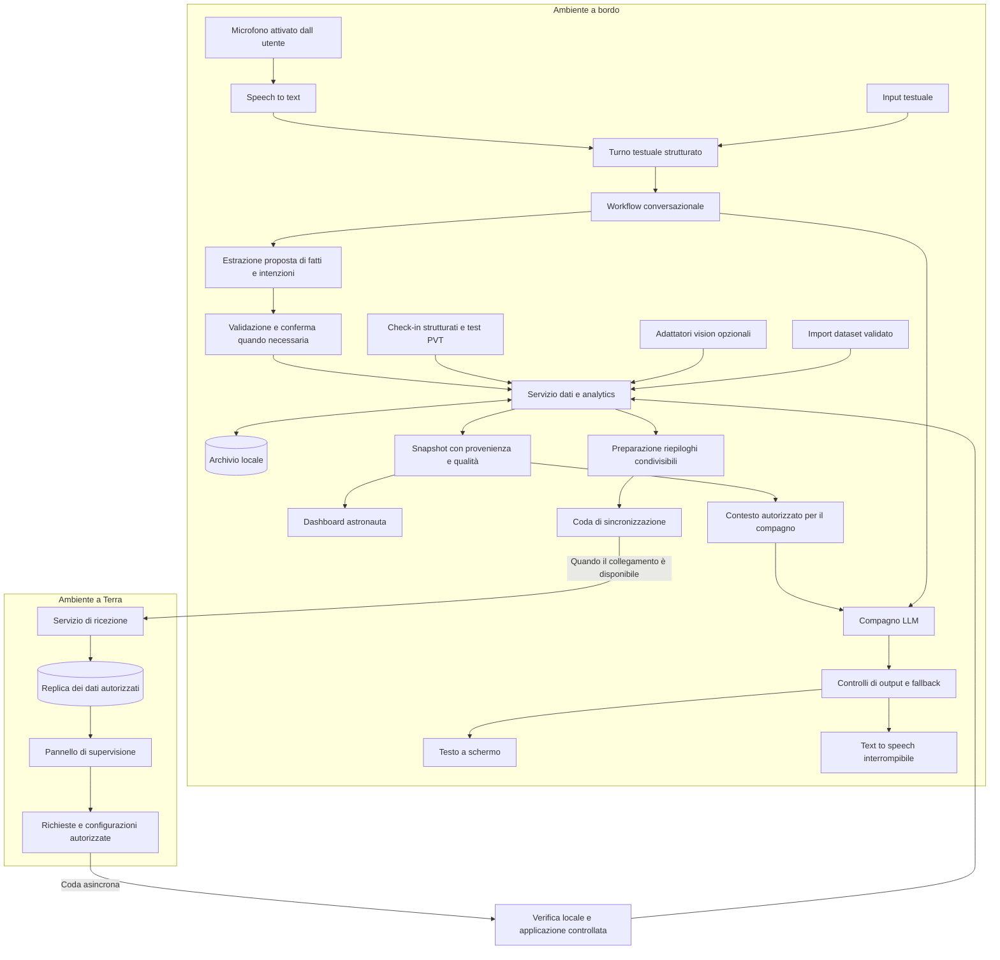

# AEGIS — Struttura proposta

**Stato:** proposta architetturale per la progettazione, non implementata.

**Data:** 14 novembre 2026 · [Visione di prodotto](docs/PROJECT.md) · [Evidenze](docs/SCIENTIFIC_FOUNDATION.md)

## 1. Decisione principale

AEGIS integra monitoraggio di **sonno, reattività e umore riferito** con un compagno vocale/testuale. La prima versione privilegia conversazione contestuale, raccolta dei dati e dashboard. Proposte di attività e relativo catalogo sono una seconda fase.

Questa priorità recepisce l'ultima decisione del team e aggiorna la precedente sequenza MVP in PROJECT, che includeva le attività già nella prima demo.

**Agente e dashboard consumano uno stesso servizio dati strutturato.** La dashboard visualizza i dati: non li organizza per conto dell'agente. L'agente non è necessario per calcolare o aggiornare i grafici.

La proposta iniziale di separare conversazione e gestione dei dati è valida come separazione di responsabilità. Non richiede due LLM autonomi: partiremo con un agente conversazionale, un servizio dati deterministico e, soltanto se utile, un modulo LLM per tradurre domande in richieste strutturate.

## 2. Flusso generale

Il diagramma rappresenta responsabilità logiche. Per l'MVP possono vivere nello stesso backend; non servono microservizi separati per ogni blocco.

## 3. Voce e agente conversazionale

La voce attraversa tre passaggi distinti:

1. **STT:** converte audio in testo; non è il ragionamento del compagno.
2. **Serializzazione e validazione:** il backend crea un messaggio con identificativi di utente, sessione e turno, timestamp, lingua, origine e trascrizione. Eventuali indicatori di qualità sono presenti solo se disponibili.
3. **Conversazione:** il workflow interpreta la richiesta, recupera il contesto necessario e genera una risposta, visualizzata e poi sintetizzata tramite TTS.

Un testo ben serializzato può comunque contenere un errore di trascrizione. Valori ambigui, negazioni e riferimenti temporali richiedono chiarimento: «cinque ore» non deve diventare una misura registrata se non è chiaro a quale notte si riferisca.

Il compagno può ascoltare, fare domande, spiegare informazioni verificate e navigare i risultati. Deve poter conversare senza attendere tutti i moduli e dichiarare quando i dati non sono disponibili. Una richiesta semplice non deve richiedere necessariamente una chiamata a un secondo LLM.

**Umore:** la conversazione può produrre una proposta di stato riferito («mi sento teso»), collegata al turno d'origine e correggibile dall'astronauta. Un'interpretazione del modello resta separata da un'autovalutazione confermata. Riconoscimento di emozioni da voce, volto o linguaggio è un'estensione sperimentale, non una misura affidabile assunta nell'MVP.

Microfono esplicito, interruzione della risposta, modalità silenziosa e alternativa testuale fanno parte del percorso principale. Non conservare audio grezzo per impostazione predefinita; definire separatamente la conservazione di trascrizioni e memoria conversazionale.

## 4. Il ruolo del servizio dati

Il componente chiamato inizialmente «agente dei dati» va diviso in due responsabilità:

| Responsabilità | Implementazione proposta |
|---|---|
| Importare dataset, normalizzare unità, controllare tipi e provenienza | Codice di ingestione e validazione |
| Salvare osservazioni, recuperare serie storiche e gestire correzioni | Repository e query parametrizzate |
| Calcolare metriche PVT, baseline, variazioni e qualità | Funzioni deterministiche versionate |
| Preparare dati per grafici e conversazione | Servizio di query con schemi condivisi |
| Interpretare «come ho dormito questa settimana?» | Eventuale LLM che propone una richiesta tipizzata |
| Eseguire la richiesta e verificarne autorizzazione e limiti | Backend deterministico |

Il modulo LLM opzionale usa strumenti ristretti, per esempio `get_sleep_history`, `get_vigilance_summary` e `get_reported_mood`. Non riceve accesso SQL libero né può alterare direttamente l'archivio. Identità e autorizzazioni provengono dalla sessione autenticata, non da un identificativo scelto nel prompt.

Per l'MVP, un unico compagno può chiamare questi strumenti senza un agente dati separato. Se in seguito il recupero diventa complesso, si può introdurre un secondo ruolo con contesto e strumenti propri, anche usando lo stesso modello. Numero di ruoli, numero di modelli e numero di processi sono scelte distinte.

## 5. Dataset, archivio e fonte dei dati

Il termine «dataset» deve essere chiarito prima dell'implementazione:

- **Dati pubblici o di ricerca:** importati con licenza, descrizione del protocollo e trasformazioni documentate; non sono la storia personale dell'astronauta e non diventano automaticamente la sua baseline.
- **Osservazioni personali:** check-in, risultati del test e segnali vision raccolti nel tempo. Costituiscono l'archivio operativo locale.
- **Dati sintetici:** fixture per demo e test, etichettate e separate dai dati reali.
- **Documentazione scientifica:** eventuale corpus di riferimento per spiegazioni, distinto dai dati numerici. Un recupero documentale non sostituisce query e analytics sulle serie temporali.

Nessun dataset concreto è stato ancora ispezionato per questa architettura. Formato, colonne, soggetti, copertura e diritti d'uso restano da verificare.

Ogni osservazione deve indicare almeno: identificativo stabile, soggetto, tipo, valore e unità o scala, momento dell'osservazione, momento di acquisizione, fonte, qualità, stato di conferma, natura reale/sintetica e versione di schema. Le correzioni devono mantenere la provenienza, senza sovrascritture silenziose.

Le metriche derivate riportano intervallo temporale, versione della regola e osservazioni di riferimento. Un dato mancante non è uno zero. Un'ipotesi del modello non è una misura.

## 6. Dashboard e contesto condiviso

Il backend espone uno snapshot coerente, ad esempio con `snapshot_id`, `as_of`, intervallo temporale, parametri, qualità e versioni delle regole. La dashboard mostra i valori strutturati; il compagno riceve la porzione autorizzata dello stesso snapshot.

**Percorso corretto:** archivio → servizio dati → dashboard e contesto dell'agente.

La dashboard non deve leggere una risposta generata per costruire i grafici. L'agente non deve leggere schermate o interrogare lo stato del frontend per sapere quali misure esistono. Eventuali filtri selezionati dall'utente possono diventare parametri espliciti della richiesta al backend.

Gli aggiornamenti possono usare polling o eventi del backend. I test PVT e le acquisizioni aggiornano l'archivio anche quando nessuno parla. Se dashboard e dialogo usano snapshot differenti, il sistema deve mostrarne il momento di aggiornamento invece di presentare i valori come simultanei.

## 7. Pannello di supervisione da Terra

Il team riferisce una raccomandazione degli istruttori per un pannello a Terra. La recepiamo come requisito di progetto; **non assumiamo che «NASA vuole controllo assoluto» sia un requisito ufficiale verificato**, né che significhi accesso indiscriminato alle conversazioni.

Il pannello iniziale offre:

- Riepiloghi autorizzati di sonno, reattività e umore riferito.
- Andamenti, qualità dei dati e indicatori con motivazioni esplicite.
- Stato dei servizi, versione di modelli/regole e ultima sincronizzazione.
- Distinzione tra ora della misura, invio e ricezione; indicazione di dati vecchi o incompleti.
- Storico di richieste, cambi di configurazione ed esiti di applicazione.

La prima versione è principalmente di consultazione. Eventuali azioni remote sono comandi tipizzati e autorizzati: richiedere un riepilogo, inviare un messaggio o proporre una configurazione entro limiti prestabiliti. Non comprendono esecuzione arbitraria di codice, accesso diretto al database di bordo o decisioni mediche autonome del modello.

### Sincronizzazione e autorità

L'archivio a bordo è autorevole per le osservazioni personali. A Terra arriva una replica dei dati previsti dalla politica di condivisione. La sincronizzazione usa una coda persistente, identificativi univoci, conferme e tentativi ripetibili senza duplicazioni. L'astronauta continua a utilizzare AEGIS senza collegamento.

Ogni comando remoto include autore, identificativo, versione attesa ed eventuale scadenza. A bordo si verificano autenticità, permessi, compatibilità e necessità di conferma umana. Il pannello distingue «inviato», «ricevuto», «applicato», «rifiutato» e «scaduto»: l'invio non equivale all'applicazione.

Per l'MVP: riepiloghi condivisi con revisione esplicita, note private separate, controllo degli accessi e audit. Eventuali esigenze operative di telemetria periodica o emergenza richiedono una politica concordata che specifichi cosa viene condiviso, con chi e quando. Il sistema non promette una confidenzialità incompatibile con tale politica.

## 8. LangChain e LangGraph

**Scelta consigliata: LangGraph per il workflow conversazionale; LangChain per integrazioni LLM, strumenti e output strutturati.** I servizi dati, i calcoli e la sincronizzazione rimangono normali componenti software.

La documentazione ufficiale distingue workflow con passaggi prestabiliti da agenti che decidono dinamicamente il proprio percorso. LangGraph permette di combinare passi deterministici e LLM con stato, streaming e interruzioni. LangChain fornisce astrazioni e integrazioni per modelli e strumenti; non è obbligatorio per usare LangGraph [1, 2].

Per AEGIS questa è una scelta adatta perché servono percorsi espliciti: trascrizione → interpretazione → eventuale chiarimento → recupero dati → risposta. Un insieme di agenti autonomi che si delegano compiti liberamente aggiungerebbe latenza e renderebbe più difficile riprodurre il comportamento.

LangChain supporta risposte strutturate con schemi, ma la validazione della forma non garantisce la verità dei contenuti [3]. Servono controlli applicativi su unità, range, provenienza e autorizzazioni, oltre a verifiche di aderenza delle spiegazioni ai dati.

Non occorre usare il framework per STT, TTS, visione o query SQLite. Questi componenti possono essere chiamati dai nodi del workflow. I modelli effettivi vanno scelti misurando qualità dell'italiano/inglese, tool calling, latenza e memoria sull'hardware disponibile.

Checkpoint del workflow e storico conversazionale sono dati sensibili e devono seguire la stessa politica di conservazione. Tracing e servizi cloud non sono requisiti: la demo offline deve funzionare senza inviarvi conversazioni o parametri personali.

## 9. Stack iniziale proposto

| Area | Proposta | Stato |
|---|---|---|
| Backend e API | Python + FastAPI | Proposta da confermare con competenze del team |
| Schemi e validazione | Pydantic | Confini espliciti fra componenti |
| Archivio locale | SQLite | Sufficiente come punto di partenza per una workstation |
| Analytics | Funzioni Python testabili | Indipendenti da LLM e UI |
| Conversazione | LangGraph + integrazioni LangChain | Workflow limitato, strumenti controllati |
| LLM, STT e TTS | Modelli locali da confrontare | Nessun modello selezionato o requisito hardware dimostrato |
| Visione | Adattatori ai prototipi del team | Verifica di codice, output e prestazioni ancora necessaria |
| Frontend | Home conversazionale e dashboard sulla stessa API | Tecnologia da concordare |
| Terra | Backend di ricezione e vista dedicata con accessi per ruolo | Replica e scambio asincrono |

Per l'MVP conviene un backend modulare a bordo e un piccolo ricevitore a Terra. Non sono necessari infrastruttura distribuita, database vettoriale o un modello diverso per ogni ruolo senza un bisogno dimostrato.

## 10. Ordine di realizzazione e verifica

1. **Contratto dati e dataset:** ispezionare i file effettivi, definire unità, soggetti, fonti e dati sintetici.
2. **Percorso deterministico:** inserire check-in e risultati PVT, calcolare uno snapshot e mostrarlo in dashboard.
3. **Compagno testuale:** leggere lo snapshot tramite strumenti e discutere sonno, reattività e umore; chiarire le estrazioni ambigue.
4. **Voce:** integrare STT/TTS, interruzione e fallback; misurare il tempo per passaggio sul dispositivo target.
5. **Terra:** trasferire un riepilogo e mostrare ritardi, disconnessione e ricezione ripetuta senza duplicazioni.
6. **Visione:** integrare solo output definiti e verificabili, con qualità e indisponibilità esplicite.
7. **Attività, seconda fase:** catalogo revisionato, proposte contestuali facoltative e feedback.

Verifiche decisive: stesso snapshot nella dashboard e nel contesto del compagno; metriche corrette senza LLM; nessuna scrittura non autorizzata; nessuna conversione di inferenze in misure; funzionamento senza rete; fallback su errori vocali/LLM; separazione dei dati privati; comandi remoti duplicati o scaduti gestiti correttamente.

La capacità hardware e la latenza sono criteri di selezione da misurare. Non sono ancora risultati del progetto.

## 11. Riferimenti tecnici

Documentazione ufficiale consultata il 14 novembre 2026:

1. [LangGraph overview](https://docs.langchain.com/oss/python/langgraph/overview).
2. [Workflows and agents](https://docs.langchain.com/oss/python/langgraph/workflows-agents).
3. [LangChain structured output](https://docs.langchain.com/oss/python/langchain/structured-output).

**Decisioni ancora aperte:** dataset effettivo, hardware, modelli e lingue, formato dei prototipi vision, ruoli del pannello a Terra e politica di condivisione. La struttura proposta consente di deciderli senza rendere dashboard o monitoraggio dipendenti dalla generazione linguistica.
